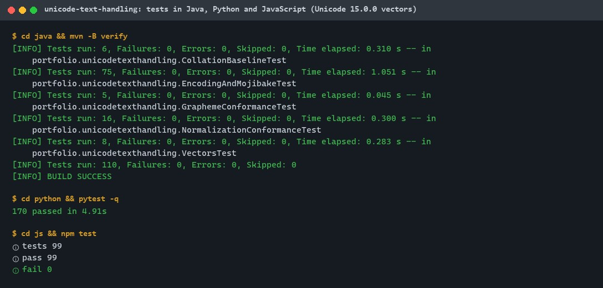
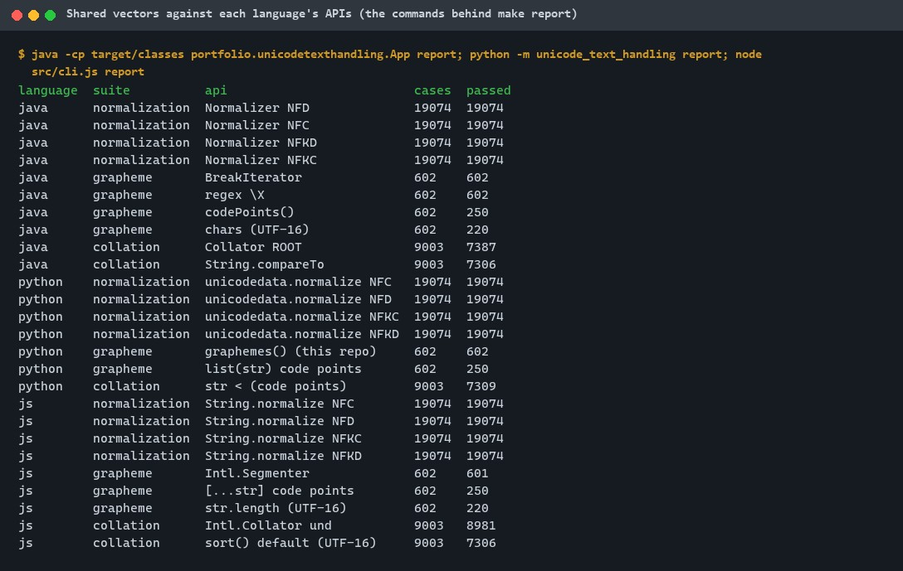
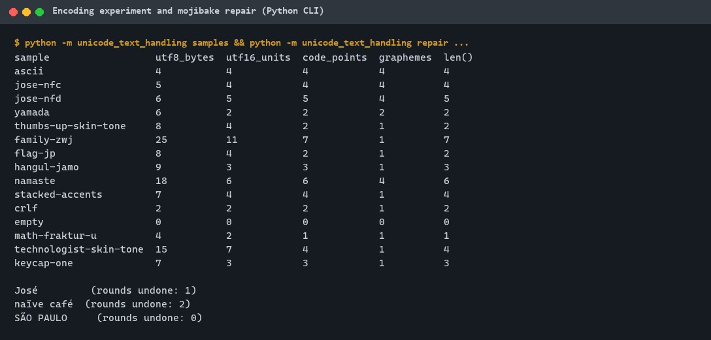
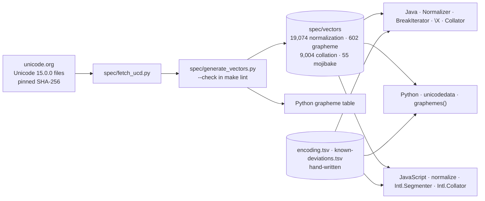
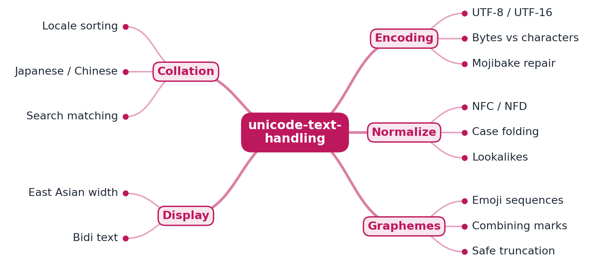
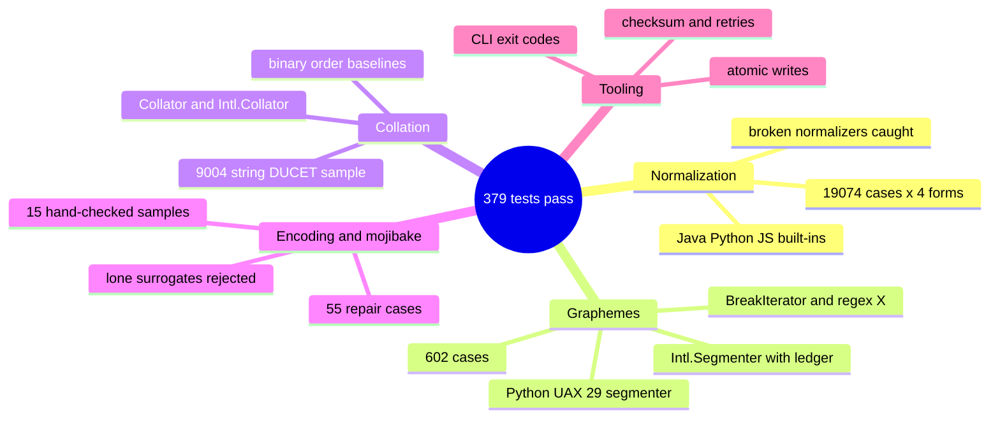

# unicode-text-handling

[](https://github.com/EquinoxWN/unicode-text-handling/actions/workflows/ci.yml)


> Why names like 'José', '山田' or one emoji break search, sorting and length checks: text handled correctly in Java, Python and JS.

Part of my **CS Foundations** list · Java · Python · JS · core project

## Proof it works

The Unicode Consortium's own conformance files (Unicode 15.0.0) are turned into one set of shared
vectors and run in all three languages: 110 Java, 170 Python and 99 JavaScript tests pass, and the
dependency audits are clean.



The same vectors scored against each language's built-in APIs (passed / cases):



The encoding experiment and the mojibake repair:



## Architecture

**What M1 runs today:**



**Full roadmap (M1 to M3):**



## How it works

_Steps 1 and 2 are built and tested (M1); the rest is on the [roadmap](#roadmap)._

1. A shared test suite built from the Unicode Consortium's data files (normalization, grapheme breaks, collation) runs against Java, Python and JavaScript.
2. Encoding experiments show why byte length, UTF-16 code units and visible characters differ, and repair common mojibake.
3. Normalization (NFC/NFD) and case folding make 'é' typed two different ways match in search and uniqueness checks.
4. Grapheme-aware truncation never cuts an emoji or accented letter in half when shortening names or previews.
5. Locale-aware collation sorts German, Japanese and Chinese lists the way native readers expect, using ICU.
6. A checklist covers database column sizes, regex pitfalls and display width for CJK text.

In M1:

- `spec/fetch_ucd.py` downloads five pinned Unicode 15.0.0 files over https (timeout, 3 attempts
  with backoff, size cap, SHA-256 check, atomic rename) into `data/`, which is git-ignored.
- `spec/generate_vectors.py` reduces them to simple line formats in `spec/vectors` that each
  language reads with its standard library. `--check` fails if the committed files drift.
- Each language runs the vectors against its own APIs. Python has no grapheme segmenter in its
  standard library, so `python/` implements UAX #29 (rules GB3 to GB999) over a generated table.
- Differences that come from a runtime implementing a newer Unicode version are listed in
  `spec/vectors/known-deviations.tsv`; tests expect exactly those, no more and no fewer.
- `measure()` gives UTF-8 bytes, UTF-16 units, code points and grapheme clusters, and rejects lone
  surrogates. `repair()` undoes UTF-8 read as Windows-1252, up to 3 times, only when the round trip
  is exact ([ADR 0003](docs/adr/0003-strict-round-trip-mojibake-repair.md)).

## Who it helps

- **Who:** Engineers who validate, store or display names and messages in Java, Python or JavaScript.
- **The problem:** A username check counts 7 "characters" in a one-emoji family, a column sized in characters overflows in bytes, and exported names arrive as 'José'. It is rarely clear which built-in API is right.
- **How to use it:** Run `make report` to see where each language's default API agrees with the Unicode conformance files, use `measure` to see all four lengths of a string before sizing a column or a limit, and `repair` to fix UTF-8 that was read as Windows-1252. The shared vectors can be reused to test your own text code.

## Tech stack

| Area | In M1 | Planned |
|---|---|---|
| Code | Java 21 (`java.text`, `java.util.regex`), Python 3.11+ (`unicodedata`, own UAX #29 segmenter), JavaScript on Node.js 24 (`Intl`) | ICU4J, PyICU for collation (M3) |
| Tests | Shared vectors generated from Unicode 15.0.0 conformance files; JUnit 5, pytest, `node:test` | - |
| Quality | `javac -Xlint:all -Werror`, ruff, `mypy --strict`, `node --check`; pip-audit, npm audit, OSV | - |
| Bench | - | Normalization and collation speed per language |

| Path | What it is |
|---|---|
| `spec/fetch_ucd.py` | Downloads and checksum-verifies the pinned Unicode 15.0.0 files |
| `spec/generate_vectors.py` | Builds `spec/vectors` and the Python grapheme table; `--check` for drift |
| `spec/vectors/` | Shared vectors, `encoding.tsv` (hand-checked samples), `known-deviations.tsv`, Unicode license |
| `java/src/main/java/portfolio/unicodetexthandling/` | `Vectors`, `Conformance`, `Graphemes`, `TextMeasure`, `Mojibake`, `App` (CLI) |
| `python/src/unicode_text_handling/` | `vectors`, `conformance`, `graphemes`, `measure`, `mojibake`, `cli` |
| `js/src/` | `vectors.js`, `conformance.js`, `text.js`, `cli.js` |

## Run it

Needs JDK 21+ with Maven, Python 3.11+ and Node.js 24+. `make lint` and `make vectors` download the
Unicode files once (about 6.5 MB) into `data/`; tests read only the committed `spec/vectors`.

```bash
make setup     # install the Python package and dev tools
make lint      # vectors up to date, javac -Werror, ruff, mypy, node --check
make test      # Java, Python and JavaScript test suites
make report    # passed / cases for each language's APIs on the shared vectors
make samples   # byte, UTF-16, code point and grapheme counts of the shared samples
make audit     # pip-audit, npm audit, OSV-Scanner on the Maven SBOM
```

Or one language at a time:

```bash
cd java && mvn verify && java -cp target/classes portfolio.unicodetexthandling.App measure "José"
cd python && pytest && python -m unicode_text_handling repair "José"
cd js && npm test && node src/cli.js measure "👨‍👩‍👧‍👦"
```

Java reads the vectors from the `uth.vectors` system property (set by `pom.xml` for tests), else
`../spec/vectors`; every CLI also accepts `--vectors DIR` as its first argument. On Windows, Java
receives command-line arguments in the ANSI code page, so `measure` with non-Latin text is
reliable only from Python or Node.js there.

## Tests and results

Latest local run (full detail in [docs/results/m1.md](docs/results/m1.md)):

| Check | Java | Python | JavaScript |
|---|---|---|---|
| Normalization, 19,074 cases × NFC/NFD/NFKC/NFKD | all pass (`Normalizer`) | all pass (`unicodedata`) | all pass (`normalize`) |
| Grapheme clusters, 602 cases | 602 `BreakIterator`, 602 regex `\X` | 602 (this repo's segmenter) | 601 `Intl.Segmenter` (1 documented Unicode 17 change) |
| One code point per character | 250 / 602 | 250 / 602 | 250 / 602 |
| One UTF-16 unit per character | 220 / 602 | - | 220 / 602 |
| Collation sample, 9,003 adjacent pairs in DUCET order | 7,387 `Collator` root, 7,306 `compareTo` | 7,309 `str <` | 8,981 `Intl.Collator`, 7,306 `sort()` |
| Encoding samples (15) and mojibake cases (55) | pass | pass | pass (Devanagari sample: 3 graphemes on Unicode 17, documented) |
| Tests passed | 110 | 170 | 99 |

| Test file | Tests | What it proves |
|---|---|---|
| `java/.../VectorsTest.java` | 8 | Shared files load; missing, oversized and malformed files fail; deviation ledger |
| `java/.../NormalizationConformanceTest.java` | 16 | `Normalizer` passes every case; the harness catches broken normalizers |
| `java/.../GraphemeConformanceTest.java` | 5 | `BreakIterator` and `\X` pass every case; naive splits score exactly the baselines |
| `java/.../CollationBaselineTest.java` | 6 | Binary orders match the baselines; root `Collator` is closer to the UCA but not equal |
| `java/.../EncodingAndMojibakeTest.java` | 75 | Encoding samples, mojibake cases, round limits, lone surrogates, CLI |
| `python/tests/test_vectors.py` | 18 | Loaders and their error paths |
| `python/tests/test_normalization.py` | 32 | `unicodedata` passes every case; harness mutants are caught |
| `python/tests/test_graphemes.py` | 17 | UAX #29 segmenter passes all 602 cases; invalid input |
| `python/tests/test_collation.py` | 5 | Code point and UTF-16 baselines |
| `python/tests/test_measure.py` | 19 | Encoding samples; lone surrogate, type and size errors |
| `python/tests/test_mojibake.py` | 62 | Mojibake cases, table, round limit, invalid input |
| `python/tests/test_cli.py` | 6 | CLI output and exit codes |
| `python/tests/test_spec_tools.py` | 11 | Download checksum, retries, size cap, https only, atomic write; generator parsing |
| `js/test/conformance.test.js` | 21 | `normalize`, `Intl.Segmenter` and sort orders against the vectors |
| `js/test/text.test.js` | 78 | Encoding samples, mojibake cases, loaders, invalid input, CLI |

What the numbers show: normalization works in every language; splitting by code point or UTF-16
unit gets most multi-code-point cases wrong (`len`, `.length`, `length()`); only ICU's
`Intl.Collator` is close to the Unicode Collation Algorithm. CI has not run yet (not pushed).
Quality check against the 10 rules, with 21 hand mutations: [docs/quality/2026-11-01.md](docs/quality/2026-11-01.md).

### Test map



## Roadmap

**M1** (≈15 h)
- [x] Write `docs/rfc/0001-design.md`: problem, goals, non-goals, chosen design
- [x] A shared test suite built from the Unicode Consortium's data files (normalization, grapheme breaks, collation) runs against Java, Python and JavaScript.
- [x] Encoding experiments show why byte length, UTF-16 code units and visible characters differ, and repair common mojibake.

**M2** (≈20 h)
- [ ] Normalization (NFC/NFD) and case folding make 'é' typed two different ways match in search and uniqueness checks.
- [ ] Grapheme-aware truncation never cuts an emoji or accented letter in half when shortening names or previews.

**M3** (≈25 h)
- [ ] Locale-aware collation sorts German, Japanese and Chinese lists the way native readers expect, using ICU.
- [ ] A checklist covers database column sizes, regex pitfalls and display width for CJK text.
- [ ] Publish the proof below with real numbers

## Proof

What this repo must show before it counts as done:

- All three languages pass the same Unicode conformance vectors, with a table of where each default API gets it wrong.

| Result | Value |
|---|---|
| M3 proof above | Not complete yet (collation needs ICU, M3). Current M1 numbers: see [Tests and results](#tests-and-results). |

## Known limitations

- Vectors are pinned to Unicode 15.0.0; runtimes on newer versions differ in the cases listed in `spec/vectors/known-deviations.tsv`.
- NormalizationTest Part 1's implicit rule (characters not listed normalize to themselves) is not checked, because it depends on which characters the runtime's Unicode version assigns.
- Collation is measured on every 20th line of the DUCET test file; the 22 pairs `Intl.Collator` orders differently have not been analysed yet.
- Mojibake repair handles UTF-8 read as Windows-1252 only, and would also change genuine text that is valid UTF-8 underneath (the literal 'é').

## Why it matters

- **Interview angle:** 'Why does our username check reject valid names?' and i18n questions for teams serving Asia.
- **Upstream I'd like to contribute to:** ICU (unicode-org/icu): documentation examples or test cases.

## Design docs

- [RFC 0001: design](docs/rfc/0001-design.md)
- [ADR 0001: record architecture decisions](docs/adr/0001-record-architecture-decisions.md)
- [ADR 0002: generate one set of shared vectors, pinned to Unicode 15.0.0](docs/adr/0002-generated-shared-vectors.md)
- [ADR 0003: repair mojibake only by a strict, bounded round trip](docs/adr/0003-strict-round-trip-mojibake-repair.md)
- [M1 results](docs/results/m1.md)
- [Quality check against the 10 rules (2026-11-01)](docs/quality/2026-11-01.md)

## Scope

This is a learning and portfolio system, not a hosted production service. Everything runs locally;
only `make lint` and `make vectors` download the pinned Unicode files.

## Security and contributing

- Every GitHub Action is pinned to a commit SHA; workflows run read-only, without persisted credentials.
- Dependabot update pull requests are paused (`open-pull-requests-limit: 0`) so the repository keeps a single `main` branch; dependencies are updated by hand and checked by the CI audit.
- Downloads are https only, size-capped and checked against pinned SHA-256 checksums.
- Report vulnerabilities privately: see [SECURITY.md](SECURITY.md). To contribute, see [CONTRIBUTING.md](CONTRIBUTING.md).

## License

MIT, see [LICENSE](LICENSE). The Unicode data in `spec/vectors` is © Unicode, Inc., under the
[Unicode License v3](spec/vectors/LICENSE-UNICODE.txt).
